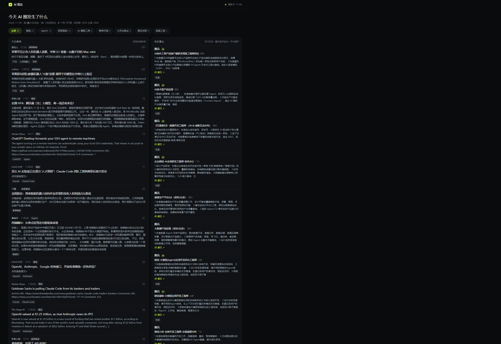
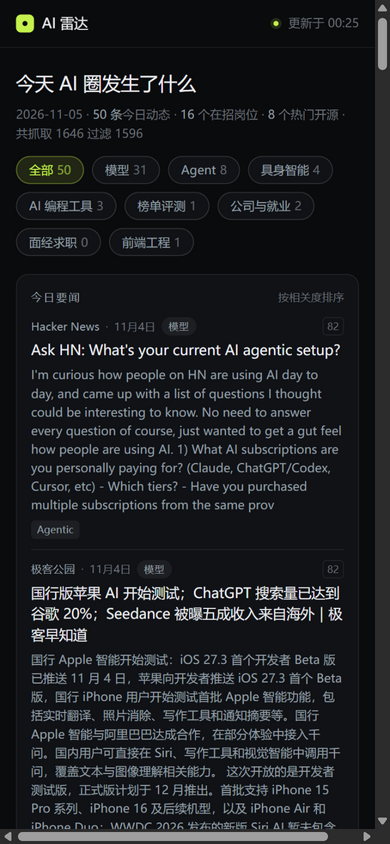

# AI 雷达

> 每天早上 07:30 自动抓取 AI 圈动态（大模型 / Agent / 具身智能 / AI 编程工具 / 大厂岗位），
> 过滤掉八卦与社会新闻，生成一份面向「前端开发者转 AI 方向」的个人情报看板。
> **零 token、零 API key、零服务器成本。**

### 👉 在线看板：<https://bright562.github.io/ai-radar/>

手机浏览器直接打开即可（"添加到主屏幕"后就是一个 App）；回看往期用 `?d=2026-11-08`。

| 桌面端 | 移动端 |
| --- | --- |
|  |  |

## ✨ 项目亮点

- **真正的自动化管道**：GitHub Actions 每天 07:30 定时执行，抓取 → 过滤 → 生成静态数据 → 自动提交，全程无人值守；
- **零 token 架构**：抓取、过滤、去重全部用 Python 标准库完成，不调用任何大模型 API——先验证"用户是否真的每天看"，再决定在哪里花钱，这是刻意的成本设计；
- **定向信息过滤**：白名单打分（9 个方向）+ 黑名单拦截 + 字符二元组 Jaccard 去重 + 时间窗，把每天 1800+ 条原始信息收敛为 50 条左右的高相关信息，"没有消息也是一种消息"；
- **官网直连**：宇树科技、智元机器人的新闻中心没有 RSS，用可配置正则直接解析列表页（站点改版只改配置里的三条正则），官网动态单独成栏——具身智能公司的一手发布不会漏；
- **不会丢历史**：每天存一份 `data/history/<日期>.json`，页面底部「往期存档」可回看最近 30 天，错过几天照样补得回来；
- **真实岗位抓取**：通过腾讯招聘官网公开接口自动拉取前端岗位（实习优先排序），并对 Boss 直聘等无公开接口的反爬渠道给出务实的降级方案，而不是硬碰反爬；
- **单一数据契约**：`digest.json` 是全系统唯一的数据契约，网页只是它的一个视图——为未来的桌面通知端（Tauri）预留了 `?d=<日期>` 深链协议；
- **响应式设计**：桌面三栏 / 移动单列自适应，"添加到主屏幕"后即是一个手机 App。

## 为什么做这个

前端开发者想转 AI 方向，最大的障碍是信息差：大模型迭代太快、岗位要求变化太快，
而公开渠道的信息要么太杂（八卦混在技术新闻里），要么太散（要盯十几个源）。

这个项目把"刷资讯"变成"看一眼"：每天一张看板，覆盖我关注的所有方向，
只推与「前端 × AI 求职」相关的内容，保持与社会不脱节，且不制造焦虑。

## 架构

```
来源白名单(RSS) ──> 抓取 fetcher ──> 过滤 filter ──> 组装 build_digest ──> data/digest.json
 pipeline/config/sources.json      keywords.json                              │
                                        │                                     ├──> 网页仪表盘（index.html）
              data/models.json ─────────┘（模型快照，月级手动维护）              └──> data/history/<日期>.json
              data/jobs.manual.json ────（岗位种子，手动维护）                        （供桌面通知端深链）
```

三层内容，更新节奏不同：

| 层 | 内容 | 来源 | 节奏 |
| --- | --- | --- | --- |
| 流 | 今日要闻（已过滤，9 个方向） | RSS 自动抓取 | 每天 07:30 |
| 图 | 模型快照（旗舰/价格/上下文）、岗位、开源、教程 | 公开接口 + 人工月度核对 | 天/月 |
| 判 | "对前端意味着什么" | **未启用**（路线图里的 LLM 层） | 接入后自动 |

页面板块：今日要闻 · 岗位雷达 · 大厂动态 · 官网动态（宇树/智元）· 模型动向 · 开源风向 · 学习资源 · 往期存档。

## 往期存档

每天的数据都会存一份 `data/history/<日期>.json`，页面底部「往期存档」列出最近 30 天，
点日期即可回看；直接访问 `?d=2026-11-08` 也能打开指定日期。

存档在每天跑完管道后自动清理到 30 份（`pipeline/run.py` 里的 `HISTORY_KEEP_DAYS`），
同时生成 `data/history/index.json` 供页面读取——所以 "前一天没看" 不会导致丢失。

## 快速开始

```bash
# 1. 生成今日数据（联网抓取，约 10-30 秒）
python pipeline/run.py

# 2. 本地预览
python scripts/serve.py
# 打开 http://localhost:8787

# 离线测试过滤效果（不联网，用内置样例数据）
python pipeline/run.py --fixture
```

> 注意：页面必须通过 http:// 访问（`serve.py` 或部署后的地址），
> 直接双击 index.html 会被浏览器的跨域限制拦住 fetch。

## 过滤规则（怎么做到"只推 AI，不推八卦"）

全部在 `pipeline/config/keywords.json`，改配置即可，不用动代码：

1. **黑名单拦截**：标题命中 明星/绯闻/命案/票房/综艺 等词（累计权重大于等于 10）→ 直接丢弃；
2. **相关度门槛**：白名单按 9 个方向打分（模型 / Agent / 具身智能 / AI 编程工具 / 榜单评测 /
   面经求职 / 就业 / 公司 / 前端工程），英文词整词匹配、中文子串匹配，
   标题全分、摘要打 4 折；总分低于 20 丢弃；
3. **时间窗**：只保留 3 天内的内容，防止 RSS 历史存档混进当天看板；
4. **去重**：标题完全一致或相似度过高（字符二元组 Jaccard ≥ 0.65）只保留相关度最高的一条。

效果验证：`python pipeline/run.py --fixture`，样例数据里故意混了八卦/社会新闻，应全部被滤掉。

## 信息源（17 个）

| 类型 | 源 |
| --- | --- |
| 中文科技/AI | 量子位、36氪、极客公园、少数派、InfoQ 中文、爱范儿、雷峰网、cnBeta |
| 英文 AI | Hacker News、TechCrunch AI、The Verge AI、VentureBeat AI、Ars Technica AI、OpenAI News、DeepMind Blog |
| 公司官网（无 RSS） | 宇树科技新闻中心、智元机器人新闻中心 |

## 怎么加信息源

RSS 源：在 `pipeline/config/sources.json` 加一行 `url` 即可。

没有 RSS 的列表页（公司官网等）：加 `"type": "html"` 和 `parse` 三条正则——
`item`（每条新闻块，至少要捕获 `url`）、`title`、`date`，站点改版只改这里，不用动代码：

```json
{
  "name": "某公司官网", "url": "https://example.com/news", "type": "html",
  "maxAgeDays": 45, "official": true,
  "parse": {
    "item": "<a href=\"(?P<url>/news/\\d+)\"[^>]*>(?P<block>.*?)</a>",
    "title": "<p class=\"title\"[^>]*>(?P<title>[^<]+)</p>",
    "date": "<p class=\"date\"[^>]*>(?P<date>\\d{4}-\\d{2}-\\d{2})</p>"
  }
}
```

单个源失败不影响其它源，会记进页面底部的"失败"计数；长期失败的可以 `enabled: false` 暂停。

## 部署（GitHub Pages，免费）

1. 新建 GitHub 仓库（Public），把本项目推上去；
2. 仓库 Settings → Pages → Source 选 `main` 分支 `/ (root)`；
3. Actions 会按 `daily.yml` 每天北京时间 07:30 跑一次，自动提交新数据；
4. `https://<用户名>.github.io/<仓库名>/` 就是公开访问地址，手机/任何设备直接打开。

Windows 本地定时（不想用 GitHub）也可以：

```powershell
schtasks /create /tn "ai-radar" /tr "python C:\<路径>\ai-radar\pipeline\run.py" /sc daily /st 07:30
```

## 数据文件职责

| 文件 | 谁写 | 说明 |
| --- | --- | --- |
| `data/digest.json` | 管道自动 | 每日一次，网页读它（schema 2：news/models/jobs/repos/learning/official） |
| `data/history/<日期>.json` | 管道自动 | 按天存档，保留 30 天，`?d=2026-11-04` 回看 |
| `data/history/index.json` | 管道自动 | 存档日期索引，页面「往期存档」读它 |
| `data/models.json` | **人工** | 模型快照：旗舰型号、代表能力、价格/上下文，每月核对（页面上有 asOf 日期） |
| `data/jobs.manual.json` | **人工** | 手动补充的岗位（Boss/智联等无公开接口的渠道） |

## 岗位抓取的现实约束

| 渠道 | 自动化 | 说明 |
| --- | --- | --- |
| 腾讯招聘官网 | ✅ 自动 | 公开 GET 检索接口，按"前端"关键词拉取，实习岗位排前 |
| Boss直聘 / 智联 | ❌ 手动 | 无公开接口、反爬严格，不要硬爬；可手动补充到 jobs.manual.json |
| 字节 / 阿里官网 | ❌ 暂不支持 | 接口需要签名或 Cookie，代码会自动降级跳过 |

开源风向与学习资源来自 GitHub 公开搜索接口（近三周新出的高星 AI 仓库与教程，按 star 排序）。

## 路线图

- [ ] **LLM 摘要层**：给相关度前 10 条加 `why` 字段（"对前端意味着什么"），前端已预留展示位（`n.why`），每天成本几分钱
- [ ] **桌面通知端**：Tauri 托盘应用，只比对 `digest.json` 的 `date` 字段，有新内容才弹系统通知，点击深链 `?d=<日期>`
- [ ] **趋势 diff**：每月对比 `models.json` 历史，自动生成"这个月什么变了"（价格降幅、上下文增长）
- [ ] **更多岗位渠道**：字节/阿里官网接口签名化；Boss/智联用浏览器插件导出后再解析
- [ ] **榜单与面经**：LMArena 等评测榜单变化；牛客等社区的面经风向（无公开 API，需评估合规方式）

## 常见问题

**Q：会消耗我的对话额度 / API token 吗？**
A：不会。管道只发 HTTP 请求 + 本地字符串处理，零模型调用。只有以后主动开启 LLM 摘要层才会花你自己的 API key 的钱。

**Q：某些源抓不到？**
A：国内网络对部分国外站点不稳定，失败源会被跳过并在页面底部计数；长期失败的可以在 sources.json 里 `enabled: false`。

**Q：怎么调"什么算 AI 新闻"？**
A：改 `keywords.json` 的权重和 `minRelevance` 门槛，重跑管道立即生效。

## License

[MIT](LICENSE)
